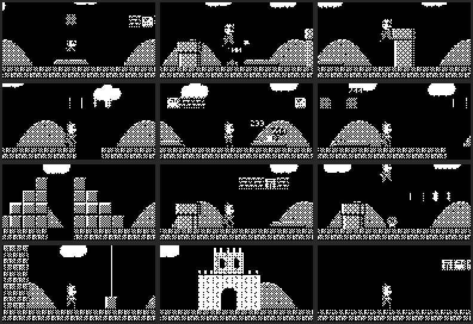

# Sipeed Examples: NanoKVM Lite side projects

Open-source examples for running your own hardware projects on a **Sipeed NanoKVM Lite**
(LicheeRV Nano / SG2002 RISC-V, Buildroot Linux) *without breaking it as a KVM*.
Copy any example folder into your own project. Each one is self-contained and has its own README.



| Example | What it does |
| :--- | :--- |
| [`oled-mario/`](oled-mario/) | Self-playing Mario platformer on a 0.96" SSD1306 OLED (128x64, I2C). Starts at boot. |
| [`oled-video/`](oled-video/) | Plays any video (a YouTube link or a local file) on the same OLED as dithered 1-bit 128x64 at up to 30 fps. |
| [`tools/backup-kvm.sh`](tools/backup-kvm.sh) | Resumable, chunked backup of the KVM's system partitions over SSH. Run it first. |

**How it all works, step by step (wiring, pin muxing, I2C from userspace, cross-compiling,
autostart, the video pipeline):** [`docs/GUIDE.md`](docs/GUIDE.md).
Start there if you want to use these techniques in your own project.

Related: the colour versions of these demos (Mario, a video-clip player and more) for the
ESP32 "Cheap Yellow Display" live in
[Novice130/ESP32-035-CYD-3.5-display](https://github.com/Novice130/ESP32-035-CYD-3.5-display).

## Hardware

| Part | Notes |
| :--- | :--- |
| Sipeed NanoKVM Lite | LicheeRV Nano-E + HDMI board. Tested on app 2.5.2, kernel 5.10.4 |
| 0.96" SSD1306 OLED, 128x64, I2C | 4-pin module (VCC, GND, SCL, SDA), address 0x3C. SH1106 1.3" panels work with `--sh1106` |
| Mac (or Linux PC) on the same network | Builds the binaries, converts videos, talks to the KVM over SSH |

Wiring (details and the reason for each pin are in the guide):

| OLED pin | NanoKVM Lite pad | Why |
| :--- | :--- | :--- |
| VCC | GPIOA16 (driven HIGH) | The 3V3 pad is covered by the HDMI board, so a GPIO powers the OLED |
| GND | GND | |
| SCL | GPIOP22 (IIC3 SCL) | Hardware I2C3, muxed by `oled-on.sh` |
| SDA | GPIOP23 (IIC3 SDA) | |

## Quick start

```sh
# on the Mac
brew install zig                        # cross-compiler for riscv64 Linux
git clone https://github.com/Novice130/Sipeed_Examples.git && cd Sipeed_Examples
export KVM=root@192.168.0.222           # your NanoKVM's IP (SSH must be enabled in its web UI)

tools/backup-kvm.sh                     # optional but recommended: back up the KVM first
cd oled-mario && ./build.sh deploy      # build + copy oled_mario, oled-on.sh, S99oledmario
ssh $KVM '/root/oled-on.sh && /root/oled_mario test'   # border + X on the OLED = wiring OK
```

Then follow the example READMEs: [oled-mario](oled-mario/README.md) (autostart at boot) and
[oled-video](oled-video/README.md) (`./play.sh <youtube-url>`).

## Ground rules (keep the KVM working)

- **Back up first** with `tools/backup-kvm.sh`. Restoring needs a USB microSD reader.
- **RAM is tight**: ~158 MB visible, ~50 MB free with the KVM services running. Everything here is a
  small static C++ binary; heavy work (video decoding) happens on the Mac.
- **GPIOA16 is the UART0 TX pad.** Using it to power the OLED stops the serial console until the next reboot.
- If your KVM exports its `/data` partition as USB mass storage, never mount it read-write on the KVM
  while the host PC has it mounted.

## Repository layout

```
├── README.md            # this file
├── docs/GUIDE.md        # the detailed how-it's-done guide
├── oled-mario/          # Mario on the OLED: oled_mario.cpp, mono.h, include/ (game engine), init script
├── oled-video/          # video player: convert.py (Mac), oled_video.cpp (KVM), play.sh
└── tools/backup-kvm.sh  # SD card backup over SSH
```

## License

MIT, see [LICENSE](LICENSE). The Mario example is a hand-made fan tribute (no ripped assets).
Only play videos you have the right to use. Converted videos stay in the git-ignored `oled-video/videos/`.
